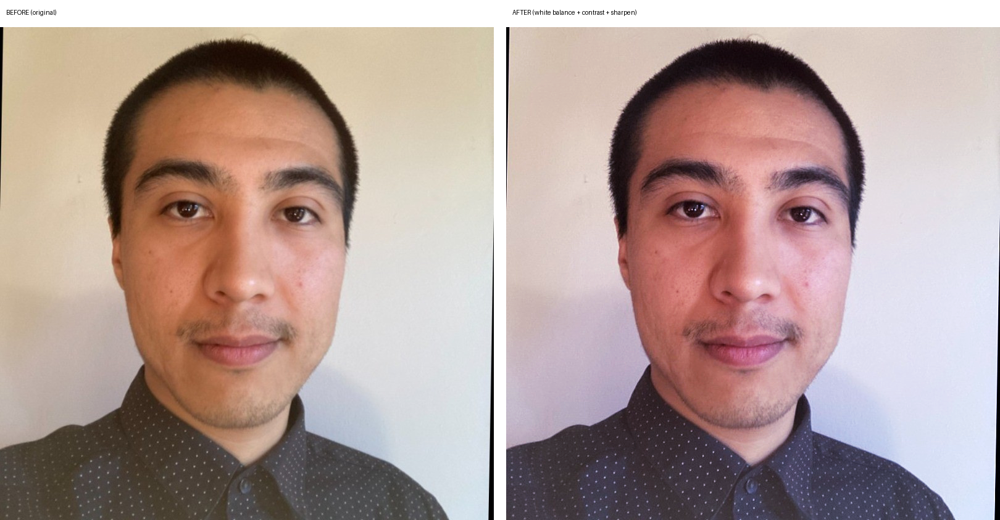
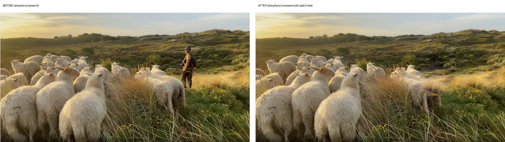

# Samples

Before/after edits produced with PhotoCraft's headless engine — no GUI involved.
Each sample lists the exact commands so you can reproduce it.

## Selfie white-balance correction

Indoor tungsten lighting had thrown a warm yellow cast over this selfie. Three
commands: cool the white balance toward neutral, a gentle S-curve for depth, and
a light smart-sharpen pass.



```sh
photocraft-cli run selfie.jpg \
  --cmd image.adjustments.colorBalance \
  --params '{"midtones":[0,0,22],"shadows":[0,0,10],"highlights":[0,0,12],"preserveLuminosity":true}' \
  --cmd image.adjustments.curves \
  --params '{"points":[[0,0],[64,56],[128,128],[192,200],[255,255]]}' \
  --cmd filter.sharpen.smartSharpen \
  --params '{"amount":70,"radius":1.0,"reduceNoise":12}' \
  --out selfie-graded.png
```

Note: `image.adjustments.colorBalance` follows Photoshop's slider convention —
negative values on the yellow-blue axis add yellow, positive values add blue.
Cooling a warm cast means pushing positive.

## Object removal — shepherd

Removing a person from a landscape with the patch tool: select the region,
drag the selection toward clean donor pixels, and the engine blends the fill.
Three passes — the body, then the head, then the hat tip (each found by
inspecting the intermediate result).



```sh
# Pass 1: body + staff, donor is the shrubbery to the right
photocraft-cli run field.png \
  --cmd select.rect --params '{"x":1290,"y":330,"width":280,"height":330,"feather":6}' \
  --cmd paint.patch --params '{"offset":[340,-30],"mode":"source"}' \
  --cmd select.deselect \
  --out step1.png

# Pass 2: remaining head
photocraft-cli run step1.png \
  --cmd select.rect --params '{"x":1385,"y":285,"width":140,"height":100,"feather":6}' \
  --cmd paint.patch --params '{"offset":[200,-10],"mode":"source"}' \
  --cmd select.deselect \
  --out step2.png

# Pass 3: hat tip
photocraft-cli run step2.png \
  --cmd select.rect --params '{"x":1415,"y":258,"width":65,"height":42,"feather":4}' \
  --cmd paint.patch --params '{"offset":[150,0],"mode":"source"}' \
  --cmd select.deselect \
  --out field-no-shepherd.png
```

The feathered selections keep the seams invisible; the donor regions were picked
by eye for matching vegetation texture at the same depth.
