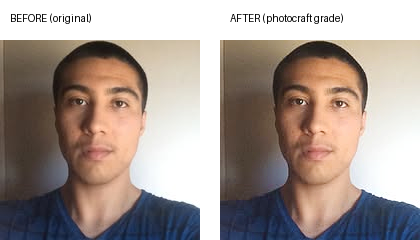

# Samples

Before/after edits produced with PhotoCraft's headless engine — no GUI involved.
Each sample lists the exact commands so you can reproduce it.

## Portrait grade

A three-command portrait grade run entirely through `photocraft-cli`:



```sh
photocraft-cli run portrait.jpg \
  --cmd image.adjustments.curves \
  --params '{"points":[[0,10],[64,74],[128,142],[192,202],[255,255]]}' \
  --cmd image.adjustments.vibrance \
  --params '{"vibrance":35,"saturation":5}' \
  --cmd filter.sharpen.smartSharpen \
  --params '{"amount":60,"radius":0.8,"reduceNoise":15}' \
  --out portrait-graded.png
```

What each step does:

1. **Curves** — a gentle lift through the shadows and midtones to open up flat lighting.
2. **Vibrance** — +35 vibrance for skin tone without oversaturating.
3. **Smart Sharpen** — light pass (amount 60, radius 0.8) for crispness.

Produced with `photocraft-cli` (v0.6.0). Every action above is a command from the
engine registry, so the same edit runs identically from the UI, a script, or an
MCP-driven agent.

## Selfie white-balance correction

Indoor tungsten lighting had thrown a warm yellow cast over this selfie. Three
commands: cool the white balance toward neutral, a gentle S-curve for depth, and
a light smart-sharpen pass.


```sh
photocraft-cli run selfie.jpg \
  --cmd image.adjustments.colorBalance \
  --params '{"midtones":[0,0,22],"shadows":[0,0,10],"highlights":[0,0,12],"preserveLuminosity":true}' \
  --cmd image.adjustments.curves \
  --params '{"points":[[0,0],[64,56],[128,128],[192,200],[255,255]]}' \
  --cmd filter.sharpen.smartSharpen \
  --params '{"amount":70,"radius":1.0,"reduceNoise":12}' \
  --out selfie-graded.png
```

Note: `image.adjustments.colorBalance` follows Photoshop's slider convention —
negative values on the yellow-blue axis add yellow, positive values add blue.
Cooling a warm cast means pushing positive.
